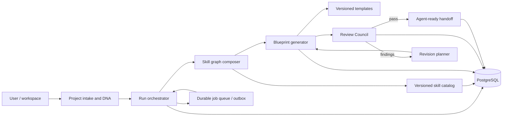

# SkillForge Platform Architecture

> **The Operating System for AI Expertise**<br>
> Transform human intent into structured expertise packages that AI agents can execute.

**Status:** Design proposal, first design phase<br>
**Scope:** Platform architecture and foundational contracts only; no application implementation<br>
**Canonical supporting artifacts:** [`schema.sql`](architecture/schema.sql), [`skill.schema.json`](../skills/skill.schema.json), [`catalog.yaml`](../skill-categories/catalog.yaml)

## 1. Product and design intent

SkillForge is an expertise composition engine. It turns a project brief into a traceable, reviewed, versioned set of decisions and agent-ready instructions. It is not a prompt library, marketplace, or chatbot. Its primary product is a reproducible execution package, not a conversation or an isolated prompt.

### Confirmed requirements

- Accept project intent across the requested product categories.
- Determine required expertise, select skills, construct a skill graph, assign priorities, deduplicate responsibilities, and resolve conflicts.
- Produce Project DNA, strategy, design, architecture, flows, data and AI designs, quality gates, launch planning, and an agent execution package.
- Every skill contains the 13 required sections in the skill contract.
- Run the Review Council before accepting a package; revise below-threshold work.
- Produce structured thinking, systems, quality rules, and blueprints before implementation instructions.
- Keep generated systems reusable, composable, scalable, and agent-ready.

### Proposed implementation choices

These are design recommendations, not requirements already settled by the request:

1. **PostgreSQL is the transactional source of truth.** It fits the repository's existing PostgreSQL/Drizzle foundation and supports relational integrity plus JSONB for versioned, structured documents. The relational model is specified in `docs/architecture/schema.sql`; it is a proposal, not a migration.
2. **Immutable revisions and append-only evidence.** Project revisions, skill versions, templates, run events, review findings, and generated artifact versions are preserved. Mutable rows point at the current revision; they do not erase history.
3. **A modular monolith first, with asynchronous run workers.** Keep domain modules in one deployable application and isolate composition/review work behind durable jobs. Split services only when measured scale or independent operational needs justify it.
4. **Provider-neutral model and storage adapters.** No model vendor, vector database, identity provider, or cloud is mandated. Keep model use optional and explicitly recorded; use object storage only for large payloads, with metadata and checksums in PostgreSQL.
5. **Tenant-owned projects.** Model organizations and memberships from the beginning. Enforce tenant scope in authorization and database access; do not treat opaque IDs as authorization.
6. **Council defaults are proposed defaults.** Use an 80/100 overall threshold, no mandatory reviewer below 3/5, and at most three revision rounds before blocked human review. These values require product-owner confirmation before production policy is frozen.

### Unresolved decisions

- Identity provider, organization creation/invitation flow, and whether personal workspaces are supported.
- Initial supported model providers, whether model output is used at all in v1, and whether customer-managed model credentials are allowed.
- Hosting, regions, data residency, retention/deletion periods, backup objectives, and supported compliance regimes.
- Commercial plan limits, quotas, usage billing, and whether any private skill sharing is needed. A public marketplace is explicitly out of scope.
- Final council threshold, mandatory reviewers per project class, reviewer independence policy, and whether human sign-off is required for all or selected projects.
- Whether a project can execute an agent package in-product, or only export it to an external agent. This design assumes **export/handoff only** for the initial platform.
- Initial supported locales, artifact export formats, and whether binary attachments are in scope.

## 2. System boundaries and component responsibilities

| Component | Responsibility | Must not own |
|---|---|---|
| Project intake | Validate brief, category, constraints, target outcomes, and tenant authorization; create an immutable project revision. | Skill selection policy or agent execution. |
| Project DNA engine | Structure stated and inferred project facts; track confidence, source, and unknowns. | Silently convert assumptions into confirmed facts. |
| Skill catalog | Publish immutable, validated skill versions and category/tier metadata. | Per-run selection decisions or customer project data. |
| Skill composer | Build a deterministic expertise graph from a project revision, catalog snapshot, and versioned policy. | Persisting mutable catalog content or executing generated tasks. |
| Blueprint generator | Render canonical artifact types from normalized graph, DNA, and versioned templates. | Marking an artifact reviewed without evidence. |
| Review Council | Evaluate evidence against versioned criteria; produce scores, findings, and a gate decision. | Editing output invisibly or bypassing failed gates. |
| Revision orchestrator | Route actionable findings back to the smallest applicable generation stage and restart affected reviews. | Mutating prior runs or hiding the revision trail. |
| Agent handoff | Package reviewed artifacts, dependencies, constraints, provenance, and explicit execution boundaries. | Running arbitrary generated shell commands or accessing secrets. |
| Knowledge registry | Track approved reference sources, licensing/usage metadata, freshness, and provenance. | Treating untrusted retrieved text as system policy. |
| Persistence and job layer | Persist tenant-scoped state, idempotency, events, and durable asynchronous work. | Business-policy decisions embedded in queue mechanics. |
| Observability and evaluation | Measure stage latency, reliability, quality, cost, drift, and regressions with privacy-safe telemetry. | Logging full private briefs or artifact bodies by default. |

### Logical architecture



The diagram is logical, not a mandated deployment topology. PostgreSQL stores authoritative state; a queue transports work and must not become the only record of a run.

## 3. Repository structure

The following requested top-level directories are established as **design-stage package boundaries**. Their README files define intended ownership; they do not imply that runtime code or full skill content exists.

```text
/
├── agents/                 # Handoff manifests, policies, and external-agent adapters
├── blueprints/             # Artifact contracts and output format definitions
├── composer/               # Composition stages, policies, and graph contracts
├── docs/
│   ├── SKILLFORGE_ARCHITECTURE.md
│   └── architecture/
│       └── schema.sql      # Proposed relational model; not applied to a database
├── knowledge/              # Curated source registry and provenance policy
├── projects/               # Project and Project DNA contracts
├── reviewers/              # Council rubric, evidence, and revision policy
├── skill-categories/
│   └── catalog.yaml        # Requested project categories and role taxonomy
├── skills/
│   ├── README.md
│   └── skill.schema.json   # Normative skill package shape; no full skills included
└── templates/              # Versioned blueprint rendering templates
```

Keep application routes, UI, database adapters, and infrastructure in implementation-specific locations when that phase begins. The design boundaries above should become modules, not necessarily independently deployed services.

## 4. End-to-end lifecycle and stage gates

Every composition is an immutable `composition_run` bound to one `project_revision`, one catalog snapshot, one template-set version, and one composition-policy version. A retry is a new attempt or a resumed durable stage, never an in-place rewrite of accepted output.

| Stage | Work | Gate / persisted evidence |
|---|---|---|
| 0. Intake | Authenticate actor; authorize tenant/project; validate category and brief; capture constraints, desired outcomes, and idempotency key. | Valid request; authorized scope; request hash and project revision recorded. |
| 1. Understand | Parse explicit facts, identify ambiguity, extract constraints, and label assumptions with confidence and provenance. | Project DNA draft is schema-valid; unresolved critical questions are flagged, not fabricated. |
| 2. Expertise plan | Select candidate skill versions, capabilities, and required reviewer coverage. | Candidate set and policy/catalog snapshots recorded. |
| 3. Compose graph | Build nodes and typed edges, deduplicate overlapping duties, assign priority, and resolve or surface conflicts. | Graph invariants pass; unresolved blocking conflicts prevent generation. |
| 4. Blueprint | Generate the required artifacts using versioned templates and structured inputs. | Required artifact set exists; schema, cross-reference, completeness, and provenance checks pass. |
| 5. Council review | Run all mandatory reviewer roles against artifact versions and rubric. | Each reviewer submits evidence and score; all hard gates pass and threshold is met. |
| 6. Revision | Convert findings into scoped revision tasks; regenerate affected artifacts and dependent outputs; rerun impacted reviewers plus council-wide regression checks. | Revision count and lineage recorded; no finding silently disappears. |
| 7. Accept | Freeze an accepted package revision and manifest with checksums, lineage, reviewer decisions, and policy versions. | Council gate passed; package status becomes `accepted`. |
| 8. Handoff | Export package and execution manifest, with explicit boundaries and target-agent compatibility metadata. | Export checksum and recipient/actor recorded; handoff does not imply execution. |

### Run status model

Recommended statuses: `queued → understanding → composing → generating → reviewing → revising → accepted`; terminal alternatives are `rejected`, `blocked`, `cancelled`, and `failed`. A retryable infrastructure failure may return a stage to `queued` only with an event recording the prior attempt. Domain-level failure is not converted into a success-shaped empty package.

Allowed transitions must be enforced by the orchestration service and checked against the prior status using optimistic concurrency (`version`/`updated_at`). `accepted` is immutable; corrections create a new run linked to the prior run. A `blocked` run includes a reason code, unresolved decision/finding IDs, and a clear next action.

## 5. Project DNA and artifact package

### Project DNA contract

Every project revision produces the following fields. Each field should distinguish `confirmed`, `inferred`, `unknown`, and `not_applicable`; inferred content carries confidence and provenance. Unknowns remain explicit until resolved.

1. Vision
2. User
3. Problem
4. Market
5. Differentiation
6. Business Model
7. Core Features
8. User Flows
9. Technical Stack
10. Architecture
11. Success Metrics
12. Risk Analysis
13. Roadmap

Capture source brief, category, constraints, assumptions, open questions, and revision lineage alongside those fields. Preserve the user's raw input separately from normalized content, subject to privacy and retention policy.

### Canonical generated artifacts

The accepted package contains these named deliverables (format defaults to Markdown unless the artifact contract specifies structured JSON):

- `MASTER_SKILL_PACKAGE.md` — selected skills, scope/priority, graph summary, and execution sequence.
- `PROJECT_DNA.md` — complete structured project definition and assumptions.
- `PRODUCT_STRATEGY.md` — users, problem, market, differentiation, business model, outcomes.
- `DESIGN_SYSTEM.md` — visual/interaction principles, tokens, accessibility and responsive constraints.
- `ARCHITECTURE.md` — system boundaries, components, integrations, quality attributes, and decisions.
- `USER_FLOWS.md` — task flows, states, errors, and recovery behavior.
- `DATABASE_DESIGN.md` — conceptual entities, access boundaries, retention, and migration concerns.
- `AI_SYSTEM_DESIGN.md` — models, context, retrieval, tools, evaluation, and safety when AI applies; otherwise state `not_applicable` with rationale.
- `AGENT_EXECUTION_PACKAGE.md` — ordered, bounded instructions and dependencies for an external agent.
- `QUALITY_CHECKLIST.md` — verifiable acceptance and review criteria.
- `LAUNCH_PLAN.md` — milestones, risks, rollout, and success measures.

Each artifact has `artifact_type`, stable `logical_key`, content/media type, schema version, template version, content checksum, source/parent references, and immutable revision. Generation is all-or-nothing for required artifacts: an incomplete package remains in draft or blocked state, not accepted.

## 6. Persistence model and schema contract

The proposed PostgreSQL model is in [`docs/architecture/schema.sql`](architecture/schema.sql). It separates mutable project pointers from immutable project/skill/template/artifact revisions and retains run-level lineage. It is a design reference, not production-ready SQL: apply only after selecting identity, retention, migration, and RLS policies.

### Entity relationships

- An **organization** owns projects, catalog visibility rules, and runs. **Memberships** bind authenticated principals to organization roles.
- A **project** has many immutable **project revisions**; each composition run uses exactly one revision.
- A **skill** has immutable **skill versions**; a published version belongs to a tier and may have multiple project-category associations.
- A **composition run** pins versions of the project, skill catalog/policy, and template set. Its graph nodes reference exact skill versions; graph edges record typed dependency, collaboration, or conflict relationships.
- A run owns artifact revisions, review cycles, reviewer assessments/findings, and append-only stage events.
- A handoff points to one accepted package revision and records its manifest checksum, destination/adapter, requester, and status.
- Knowledge sources carry source identity, approval/usage metadata, freshness, content hash, and tenant/public visibility; generated claims cite source/version IDs where applicable.

### Versioning, lineage, and constraints

- Use UUID primary keys generated by the application or database. Keep human-facing slugs separate from identifiers.
- Enforce tenant ownership via foreign keys that include `organization_id` where cross-tenant references would be unsafe; validate authorization on every read/write. PostgreSQL RLS is recommended as defense-in-depth, not a substitute for application checks.
- Published skill and template versions are immutable. Updating content creates a new version; deprecating a skill does not rewrite old graphs.
- Each run captures catalog, policy, rubric, generator, and template-set versions; retain the resulting resolved graph and artifact source map so a package can be audited even after catalog changes.
- Add unique constraints for `(organization_id, project_slug)`, `(skill_id, version)`, `(template_set_id, logical_key, version)`, `(run_id, node_key)`, `(run_id, source_node_id, target_node_id, edge_type)`, `(run_id, artifact logical_key, revision)`, and `(organization_id, idempotency_key)` where applicable.
- Use partial indexes for active queue/status scans, B-tree indexes for tenant + recency and foreign-key joins, and GIN only for intentional JSONB containment queries. Do not index full private text or add broad full-text indexing without an explicit privacy and product need.
- Use optimistic concurrency for mutable project pointers and run state. Events, review decisions, published versions, and accepted artifacts are append-only.
- Prefer normalized columns for identity, authorization, status, version, and relationships. JSONB is for contract-versioned domain documents, not opaque storage of the whole system.
- Store large exports in encrypted object storage only when needed; persist object key, checksum, size, encryption classification, and deletion state in the database.

### Core state transitions

`project`: `active ↔ archived`; hard deletion is governed by retention and legal-hold policy.<br>
`skill_version` / `template_version`: `draft → published → deprecated`; published content is immutable.<br>
`composition_run`: lifecycle from Stage 0–8 above, with terminal `accepted`, `blocked`, `rejected`, `cancelled`, or `failed`.<br>
`blueprint_artifact`: `draft → generated → under_review → accepted`; revisions may be `superseded` but never overwritten.<br>
`agent_handoff`: `prepared → exported → acknowledged` or `failed`/`revoked`; status does not represent external agent execution.

The SQL file encodes representative keys, checks, and indexes. Exact partitioning, retention jobs, row-level policies, encryption strategy, and migration mechanics remain deployment decisions.

## 7. Skill framework and taxonomy

The normative skill payload is [`skills/skill.schema.json`](../skills/skill.schema.json). A publishable skill version must have all 13 required sections:

1. Identity
2. Mission
3. Principles
4. Mental Models
5. Decision Frameworks
6. Best Practices
7. Anti Patterns
8. Review Criteria
9. Quality Metrics
10. Acceptance Criteria
11. Output Contract
12. Examples
13. Failure States

Each section is structured, bounded, and versioned. Skill output should state scope, required inputs, assumptions, outputs, dependencies, stop conditions, and evidence. Examples are illustrative rather than authority. A skill cannot grant permissions or override platform safety, tenant policy, or user approval.

### Skill tiers and roles

| Tier | Name | Roles |
|---|---|---|
| 1 | Core Thinking | Product Strategist, Systems Thinker, UX Architect, Business Analyst |
| 2 | AI | AI Product Manager, Agent Architect, RAG Architect, Evaluation Engineer, Context Engineer, Knowledge Graph Architect, Prompt Engineer, Model Selection Expert |
| 3 | Web | Frontend Architect, Backend Architect, API Architect, Database Architect, Cloud Architect |
| 4 | Creative | Creative Director, Art Director, Storytelling Expert, Motion Director, Brand Strategist |
| 5 | WebGL | Three.js Architect, R3F Architect, GSAP Architect, Shader Engineer, Technical Artist, Rendering Engineer, Post Processing Engineer |
| 6 | SaaS | B2B SaaS Expert, PLG Expert, Retention Expert, Monetization Expert, Growth Designer |
| 7 | Review | Product Reviewer, Architecture Reviewer, UX Reviewer, Performance Reviewer, Security Reviewer, Accessibility Reviewer, Awwwards Reviewer |

Review Council roles are capabilities assigned to reviewers, not assumptions that a role in Tier 7 is the only reviewer. For example, Systems Architect, Performance Engineer, and Security Engineer can be mapped to versioned reviewer profiles/criteria while keeping the requested skill taxonomy intact.

### Skill package lifecycle and authorship

Skill content should be reviewed before publication, carry a stable `slug`, semantic `version`, tier, role, capability tags, applicability/exclusion criteria, input/output contracts, dependencies, conflicts, provenance, author/reviewer identity, and status. A skill version is eligible for composition only when published and schema-valid. Restrict skill authoring/publication to authorized roles; treat imported content as untrusted until reviewed.

## 8. Skill graph composition

### Graph data model

- **Node:** one selected immutable skill version, a stable run-local `node_key`, assigned scope, priority, rationale, confidence, and source evidence.
- **Edge:** a typed directed relation: `depends_on`, `collaborates_with`, `supersedes_scope`, `conflicts_with`, or `reviews`. Store origin (explicit skill declaration, policy, or inferred proposal), evidence, and resolution.
- The run graph is a DAG for execution dependencies. Collaboration/review/conflict references may be non-DAG metadata edges and must be excluded from topological execution ordering.

### Deterministic composition procedure

1. Normalize the brief into explicit requirements, constraints, project category, quality attributes, and uncertainty markers. Keep stable normalized inputs separate from model-generated interpretation.
2. Match requirements to versioned skill capability tags and applicability predicates. Apply mandatory category mappings and explicit user constraints before inferred relevance.
3. Rank eligible skills with a versioned deterministic score: `match = Σ(requirement_weight × capability_match × confidence)`, then apply tier/category policy, explicit inclusions/exclusions, and minimum coverage. A model may suggest candidates, but it does not make an unrecorded final selection.
4. Select a pinned set using deterministic ordering: mandatory before optional, higher coverage score first, then stable `skill.slug`, then version. Store all candidates, scores, exclusions, and policy version for explanation.
5. Deduplicate overlapping responsibilities by comparing declared scopes/capabilities and requirement coverage. Keep the skill with clearer ownership and stronger matched evidence as primary; narrow the other scope or remove it only if coverage is preserved. Record each action and affected requirement.
6. Resolve conflicts in this order: explicit user/project constraint; platform safety/privacy policy; hard skill compatibility constraint; category policy; higher-priority skill with evidence; otherwise leave a conflict unresolved and block generation. Never resolve a conflict by silently dropping a hard constraint.
7. Build edges from declared dependencies and resolved ownership, check all dependencies exist and are compatible, detect cycles, and topologically sort execution nodes. Break equal ordering with stable keys. A dependency cycle is a blocking validation error, not an arbitrary ordering choice.
8. Persist final nodes, edges, selection/exclusion rationale, conflict decisions, graph hash, and provenance to the run. Regeneration with identical pinned inputs and policy must produce the same graph decisions; nondeterministic model suggestions are separately recorded and cannot change the final graph without policy evaluation.

Priority bands are `P0` blocking decisions/safety/core architecture, `P1` required product outcomes, `P2` quality and supporting capabilities, and `P3` optional enhancements. The composer derives priority from requirement criticality and explicit user constraints; each assignment includes rationale. Do not infer priority from skill tier alone.

## 9. Blueprint generation, templates, and package validation

Templates define artifact type, schema/version, required sections, allowed variables, rendering rules, constraints, and validation rules. They are immutable after publication and are selected by stable template ID plus version. Render structured data first, then Markdown or export format; do not use unescaped string concatenation for untrusted input.

Generation consumes only a pinned project revision, graph, skill versions, knowledge references, template set, and generator/policy versions. For each artifact record input lineage, template/version, generator version, content hash, and validation results. Support deterministic re-rendering where possible; if generative model output is used, persist provider/model/version and generation settings needed for audit, subject to privacy policy.

Package validation checks:

- All canonical artifact logical keys are present and each artifact conforms to its versioned schema.
- Project DNA required fields exist and unknown/inferred fields are explicitly labeled.
- Every major recommendation is linked to a source requirement, graph node, decision, or approved knowledge source.
- Artifact cross-references resolve to the same package revision; no stale artifact from an older revision is included.
- Required skill outputs and dependencies are represented; no conflicting ownership remains unresolved.
- Design/architecture/quality constraints agree across artifacts; contradictions create actionable findings.
- Agent instructions identify prerequisites, bounded tasks, expected outputs, tests/evidence, stop conditions, and prohibited actions.
- Export manifest enumerates artifact paths, media types, schema versions, hashes, dependency order, review status, and lineage.

## 10. Review Council and revision loop

### Mandatory council

Each accepted package is reviewed by the requested roles: **Creative Director, Product Strategist, Systems Architect, Performance Engineer, Security Engineer, UX Architect, Accessibility Reviewer, and Awwwards Reviewer.** Use versioned role-specific criteria and qualified reviewer profiles. A reviewer may be a deterministic evaluator, model-based evaluator, or human, but the mechanism and version must be explicit; a model reviewer is not independent from a model generator unless the policy accounts for that risk.

### Scoring policy (proposed defaults)

Each reviewer assigns 0–5 per applicable dimension and supplies evidence for each score. Convert weighted dimensions to 0–100 per reviewer. Suggested shared dimensions: requirement coverage, correctness/coherence, clarity/actionability, evidence/provenance, risk handling, and maintainability. Add role-specific dimensions:

- Creative Director: distinctiveness and coherent creative direction.
- Product Strategist: user/problem fit, differentiation, outcome and business logic.
- Systems Architect: boundaries, dependencies, operability, and failure handling.
- Performance Engineer: measurable performance budgets and scaling assumptions.
- Security Engineer: threat coverage, data boundaries, least privilege, safe handoff.
- UX Architect: task completion, information architecture, errors and recovery.
- Accessibility Reviewer: applicable accessibility criteria and testable acceptance.
- Awwwards Reviewer: craft, originality, visual quality, and interaction quality; aesthetic judgment cannot override usability, accessibility, or security.

Proposed acceptance gate: every mandatory reviewer >= 80/100, overall weighted mean >= 80/100, no mandatory dimension < 3/5, zero unresolved critical/high findings, and all deterministic package/schema checks pass. Set role weights in a versioned rubric; default equal weights until product validation. Scores always cite artifact ID/revision, section or JSON pointer, rubric version, rationale, and evidence. A reviewer must say `not_applicable` with rationale rather than score an irrelevant dimension as passing.

### Revision, termination, and blocked states

- A failed score produces a finding with severity (`critical`, `high`, `medium`, `low`), affected artifact pointers, requirement/skill lineage, evidence, and concrete acceptance condition.
- The revision planner groups findings by affected artifact/dependency and regenerates the smallest safe scope; dependent artifacts are invalidated and regenerated when their inputs change.
- Re-review changed artifacts with the owning reviewer, then run all mandatory reviewers on the final package to catch regressions. Prior findings remain in history and are marked resolved only with evidence.
- Permit at most **three** automated revision rounds by default (proposed). If the gate still fails, transition to `blocked` with remaining findings and a human decision path; do not lower thresholds or accept by timeout.
- Immediately block on safety/privacy violations, unsupported claims without evidence, missing mandatory artifacts/reviewers, unresolved hard conflicts, or malformed output.
- Allow `rejected` for user cancellation of the requested package, `cancelled` for explicit authorized cancellation, and `failed` only for unrecoverable system failure. Preserve partial work as non-accepted draft evidence when safe.

Human approval can resolve an explicitly user-owned ambiguity or choose among documented alternatives, but cannot override platform safety policy. Record actor, timestamp, decision, rationale, affected findings, and resulting new run/revision.

## 11. Agent execution handoff and safe boundaries

The initial execution package is an **instructional handoff**, not an execution environment. It should include:

- Package manifest and checksums; accepted package and project revision IDs.
- Required skills and their exact versions, ordered task graph, dependencies, priorities, and bounded scope.
- Environment assumptions, allowed tools/capabilities, expected outputs, measurable acceptance criteria, and verification evidence.
- Explicit non-goals, stop conditions, unresolved decisions, prohibited operations, and escalation path.
- Reviewer results and any limitations that downstream agents must preserve.
- Idempotency/reference IDs and package compatibility/schema version for external consumers.

Do not embed secrets, live access tokens, production credentials, or unrestricted shell/network permissions. Do not treat generated instructions as authority to modify production systems, access another tenant, publish externally, make purchases, or deploy. A future executor must be separately authenticated and authorized, capability-scoped, approval-gated for consequential actions, logged, rate-limited, and kill-switchable. Handoff `exported` or `acknowledged` means only package delivery/receipt, never task completion.

## 12. Security, privacy, reliability, and observability

### Security and privacy

- Authenticate every principal; authorize every object access against organization membership and role. Use tenant-aware queries and composite foreign keys, with PostgreSQL RLS as defense-in-depth.
- Separate system/platform policy from user briefs, skill content, knowledge, and retrieved text. Treat all user-authored/imported/model-generated content as untrusted data; defend generation and review against prompt injection and unsafe instruction laundering.
- Apply input size/type limits, output size limits, request rate/quota controls, idempotency, CSRF protections for browser mutations, secure session/cookie practices, and abuse monitoring.
- Minimize captured data; redact credentials/secrets before persistence where feasible; never put full briefs, artifact bodies, credentials, or raw prompts into normal application logs or traces.
- Encrypt in transit and at rest; restrict operator access; manage keys separately; document backup, deletion, retention, legal hold, and data export behavior before launch.
- Use per-tenant data access controls for knowledge indexing. Avoid cross-tenant retrieval, training reuse, or analytics aggregation that can expose content. Record opt-in and retention semantics for any model-provider transmission.
- Threat model authorization bypass, IDOR, cross-tenant cache leakage, malicious skill/template content, prompt injection, model/provider data retention, unsafe generated plans, dependency compromise, export leakage, and denial-of-service.

### Reliability and observability

- Make stage work idempotent by `(run_id, stage, attempt/input_hash)` and use transactional outbox/inbox patterns so database state and queue dispatch cannot diverge silently.
- Use bounded retries with exponential backoff and jitter for transient provider/queue/storage failures; dead-letter poison jobs with inspectable failure context. Never retry a non-idempotent external side effect automatically.
- Persist stage transitions before/after execution, attempt counters, timing, input/output hashes, provider/model, policy/template versions, and failure codes. Keep sensitive content out of telemetry.
- Define SLOs only after workload targets are known. Track intake/run success, stage latency, queue age, review pass rate, revision count, blocked reasons, token/cost use, provider errors, and package validation failures.
- Correlate logs/traces with opaque run IDs and tenant-safe identifiers; enforce access controls on audit events. Alert on queue backlog, repeated stage failures, unexpected review score drift, cross-tenant authorization denials, and quality regressions.

### Evaluation strategy

- Maintain a versioned, consented evaluation set of category-stratified briefs, expected requirement coverage, must-have skills, graph invariants, artifact criteria, and known ambiguity.
- Test deterministic graph properties: identical pinned inputs → identical decisions/hash; all hard constraints covered; no unresolved cycle; every selected skill has a rationale; no deduplication loses mandatory coverage.
- Evaluate generated artifacts with schema/completeness checks plus blinded human review. Measure rubric agreement and reviewer false-pass/false-fail rate before relying on model evaluators.
- Run regression evaluations when prompts, skills, policies, templates, models, or rubric versions change; compare quality, latency, cost, and safety findings.
- Include adversarial cases: prompt injection inside briefs/knowledge, conflicting requirements, missing data, unsupported market claims, cross-tenant identifiers, harmful or disallowed requests, oversized inputs, and provider outage.
- Gate catalog, policy, template, and generator releases on required evaluation thresholds; retain dataset and evaluation version in release lineage.

## 13. Phased implementation roadmap

This roadmap preserves the requirement that thinking, systems, architecture, and quality rules precede implementation.

1. **Design freeze:** Resolve the open decisions needed for v1; approve taxonomy, skill schema, Project DNA, artifact contracts, graph policy, review rubric, retention, and security model. No application implementation.
2. **Contract validation:** Build curated example projects and validate schemas, deterministic graph cases, artifact completeness, review evidence, and export manifest using fixture-driven, non-production tooling.
3. **Foundational catalog:** Implement tenant-aware identity/project/revision persistence and versioned skills/categories/templates; publish a small reviewed set of skills rather than all roles at once.
4. **Composition and blueprint pipeline:** Implement intake through accepted blueprints with durable jobs, idempotency, lineage, deterministic composition, validation, and observable failure states. Keep external agent execution out of scope.
5. **Review Council:** Add reviewer adapters, role rubrics, evidence capture, revision planning, bounded retry/blocked workflows, and calibrated human evaluation.
6. **Export and hardening:** Add safe package export, access reviews, threat-model mitigation, backups/deletion operations, SLOs, load tests, and operational runbooks.
7. **Measured expansion:** Add remaining skills/categories and any model/provider adapters only when evaluations demonstrate quality and safety; revisit service boundaries based on workload evidence.

### Readiness criteria before application implementation

- Product owner has resolved v1 scope, auth/tenant model, execution boundary, model-provider stance, privacy/retention, and reviewer thresholds.
- Every required artifact has a versioned schema/template and representative accepted fixture.
- Taxonomy and skill contract validate; graph conflict rules and tie-breakers are testable.
- Council criteria, finding severity, revision cap, and human escalation are approved.
- Threat model, data flow, access model, retention, and evaluation strategy have owners and acceptance criteria.

## 14. Decision record summary

| Decision | Status | Rationale / tradeoff |
|---|---|---|
| PostgreSQL + immutable versions + JSONB for structured contract payloads | Proposed | Matches repository baseline and supports traceability; schema and RLS need deliberate production migrations. |
| Modular monolith plus durable asynchronous workers | Proposed | Keeps first implementation simple while isolating long-running composition; worker infrastructure adds operational complexity. |
| Provider-neutral adapters; no provider selected | Unresolved by user | Avoids coupling and invented vendor requirements; delays provider-specific cost/quality tuning. |
| External-agent handoff only; no automatic execution in phase one | Proposed conservative boundary | Prevents generated instructions from acquiring tool authority; in-product execution would require a separate security design. |
| 80/100, minimum 3/5, three revision rounds | Proposed defaults | Makes gates concrete and bounded; requires calibration against human-reviewed examples. |
| All eight requested council roles mandatory on accepted packages | Confirmed requirement | Preserves explicit requirement; operational staffing and applicability policy remain unresolved. |
| No full skills, application code, marketplace, or execution runtime in this phase | Confirmed scope boundary | This phase delivers architecture and foundational design documentation only. |
